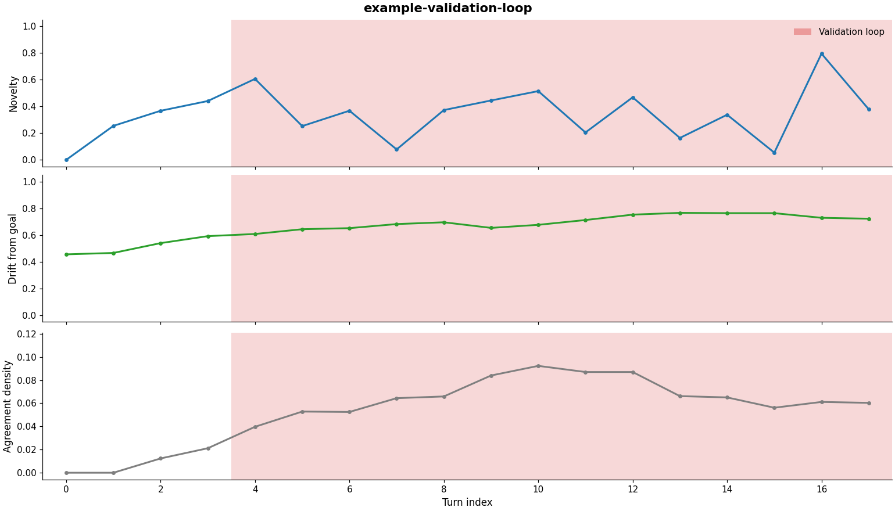

# stuck-in-the-loop

Detects when a human-AI conversation stops being productive.

Some chats with an AI go somewhere useful. Others get stuck, and usually
neither side notices. This tool looks for three patterns:

1. **Validation loop**: the user keeps asking for agreement, the AI keeps
   giving it, and nothing new gets said.
2. **Premature convergence**: both sides settle on the first answer and stop
   looking at other options.
3. **Drift**: the chat slowly moves away from what it was supposed to be about
   and never comes back.

The idea is to treat a conversation like a dynamical system. Every turn gets a
few numbers (novelty, drift from the goal, agreement) and the failures show up
as patterns in how those numbers change over the conversation.

## Install

```bash
git clone https://github.com/sobiaAi/stuck-in-the-loop
cd stuck-in-the-loop
pip install -e .
```

## Usage

```bash
python -m sil analyze examples/validation_loop.json --out chart.png
```

This saves a chart (novelty, drift and agreement per turn, with flagged turns
shaded) and prints what it found:

```
[VALIDATION LOOP] turns 4-17, severity 0.78
chart saved to chart.png
```



Results on the four example chats in `examples/`:

| Chat | Result |
|---|---|
| validation loop | `[VALIDATION LOOP] turns 4-17, severity 0.78` |
| premature convergence | `[PREMATURE CONVERGENCE] turns 10-17, severity 0.44` |
| drift | `[DRIFT] turns 11-19, severity 0.45` |
| healthy | nothing flagged |

All four charts are in [`docs/`](docs/).

## Input formats

| Format | How to get it |
|---|---|
| ChatGPT export | Settings > Data controls > Export data, then use `conversations.json` from the zip |
| Claude export | Settings > Privacy > Export data, then use `conversations.json` |
| Pasted text (`.txt` / `.md`) | copy a chat into a file. each message starts with `You said:` / `ChatGPT said:`, `User:` / `Assistant:`, or `## User` / `## Assistant` |
| json | format below |

Export files have all your chats in them. List them and pick one by number or
part of the title:

```bash
python -m sil list conversations.json
python -m sil analyze conversations.json --conversation "study plan" --goal "make a 2 week study plan"
```

Drift is measured against the goal, so give one with `--goal` or in the json:

```json
{
  "session_id": "my-chat",
  "goal": "what the chat is trying to do (optional)",
  "turns": [
    {"role": "user", "text": "..."},
    {"role": "assistant", "text": "..."}
  ]
}
```

## How it works

Each turn gets three numbers:

- **Novelty**: `1 - max cosine similarity` to the previous 3 turns (sentence
  embeddings, all-MiniLM-L6-v2). Max instead of mean, because repeating any one
  recent turn is enough to count as repetitive.
- **Drift**: `1 - cosine similarity` to the goal, smoothed with an EMA
  (alpha = 0.3) so one tangent doesn't count, only a steady move away.
- **Agreement**: agreement phrases per word. User turns are checked for
  seeking agreement ("right?", "am I correct"), AI turns for giving it
  ("exactly", "you're right"). Averaged over the last 4 turns.

Novelty zig-zags between the user and the AI, so the rules use its average
over the last 4 turns.

| Failure | Rule (at least 4 turns in a row) |
|---|---|
| validation loop | agreement > 0.03 and novelty < 0.45 |
| drift | drift > 0.85 and it doesn't come back down |
| premature convergence | novelty < 0.30 until the end, agreement <= 0.03 |

Severity is the share of the chat that got flagged. The thresholds are in
`Config` in `sil/metrics.py` and can be changed with `--config thresholds.json`.

| Setting | Value |
|---|---|
| `novelty_window` | 3 |
| `agreement_window` | 4 |
| `drift_alpha` | 0.3 |
| `min_run` | 4 |
| `agreement_ceiling` | 0.03 |
| `loop_novelty_max` | 0.45 |
| `novelty_floor` | 0.30 |
| `drift_ceiling` | 0.85 |

## Evaluation on real chats

The thresholds were set on four made-up chats, which doesn't show they work on
real ones. So the evaluation uses real conversations from
[WildChat-1M](https://huggingface.co/datasets/allenai/WildChat-1M), labeled by
hand following [`eval/LABELING.md`](eval/LABELING.md).

```bash
pip install -e .[eval]
python -m sil sample-wildchat train-00000-of-00014.parquet --n 60 --out eval
# label eval/labels.csv first, before running the detector on them
python -m sil evaluate eval                  # calibration half, used for tuning
python -m sil evaluate eval --split test     # test half, every run gets logged
```

The calibration/test split is made when the sample is drawn, before any
labeling, and every run on the test half is logged in `eval/test_log.csv`.

`analyze` also takes `--recurrence plot.png` to save a recurrence plot (the
similarity between every pair of turns).

## Limitations

- the agreement phrases are a fixed English list
- thresholds come from four made-up chats, real evaluation is in progress
- drift measures how far the topic is from the goal, not whether it's useful.
  asking about an alarm clock to wake up and study still counts as drift
- the goal has to be given. guessing it from the first few turns, and telling
  a deliberate topic change apart from drift, is future work
- works on finished chats only for now, not live

## License

MIT
